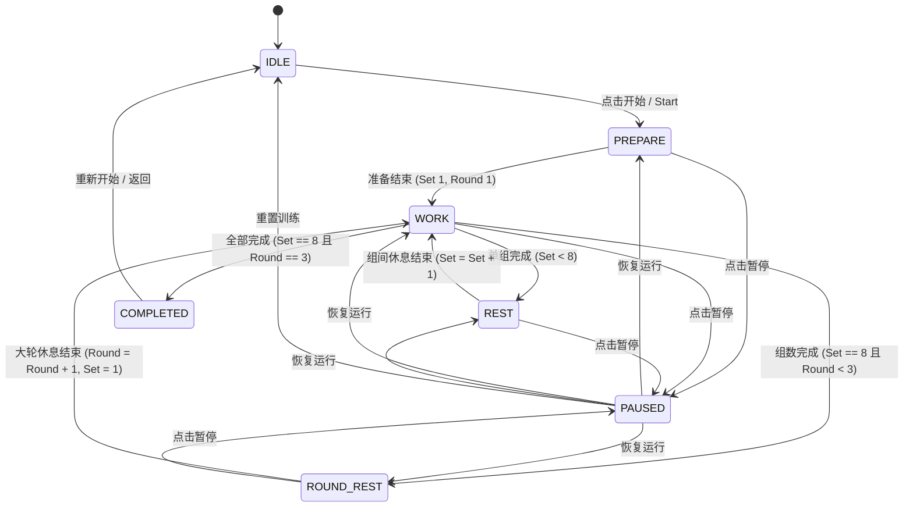

# iPhone 专属高强度跳绳间隔计时器 (Interval Timer PWA) 设计规范

## 1. 概述与核心目标 (Overview & Goals)
本项目旨在为 iPhone 用户量身打造一款专用于高强度跳绳与间歇训练（HIIT / Interval Training）的独立全屏 Web App (PWA)。该应用具备极佳的便携性与零依赖特性，可通过 Safari「添加到主屏幕」实现媲美原生 App 的沉浸式无边框体验。

### 1.1 核心需求与设计约束
1. **背景音乐零干扰 (Zero Music Interruption)**：在跳绳训练过程中，用户经常佩戴耳机播放 Apple Music、Spotify 等第三方后台音乐，计时器的提示音与音效**严禁**暂停或打断系统后台正在播放的音乐。
2. **默认内置 25.5 分钟跳绳强化方案**：
   - **准备时间 (Prepare)**: 10 秒
   - **单组做功 (Work)**: 45 秒 (00:45)
   - **组间休息 (Rest)**: 15 秒 (00:15)
   - **单轮组数 (Exercises)**: 8 组
   - **总大轮数 (Rounds)**: 3 轮 (总计 24 组做功)
   - **大轮间歇 (Round Rest)**: 45 秒 (00:45)
   - **时序总计**: $8.75\text{分} + 8.75\text{分} + 8.0\text{分} = 25.5\text{分钟}$（实际跳绳做功时间累计整 18 分钟）。
3. **全参数自定义与预设管理**：上述所有时间与轮次参数均可自由修改、加减微调，并支持创建、命名、保存、编辑及切换多套独立训练预设。
4. **超强远距离视觉辨识**：大面积高饱和度全屏背景色随运动阶段动态切换，超大号倒计时数字与状态标识，确保在 3~5 米外晃动视线下清晰可见。
5. **iPhone 屏幕常亮 (Screen Wake Lock)**：训练开始后自动保持屏幕长亮，防止锁屏中断节奏。
6. **全离线可用 (PWA Offline)**：支持 Service Worker 离线缓存，无网络环境秒开秒练。

---

## 2. 系统架构与技术选型 (Architecture & Tech Stack)

### 2.1 技术选型
* **前端核心**：纯原生现代化 Web 标准（HTML5 / ES6 模块 / CSS3），零第三方庞大构建工具，保证极小体积（< 50KB）与毫秒级加载。
* **音频引擎**：Web Audio API 原生振荡器 (`OscillatorNode` + `GainNode`) 实时程序化合成音频，杜绝使用 `<audio>` 标签避免抢占 iOS 音频焦点。
* **屏幕保活**：Screen Wake Lock API (`navigator.wakeLock`) + `document.visibilitychange` 自动恢复机制。
* **数据持久化**：`localStorage` 本地安全沙盒持久化预设与偏好设置。
* **PWA & 离线**：标准 Web App Manifest (`manifest.json`) + Service Worker (`sw.js`) 缓存静态资源。

### 2.2 目录与文件组织
```text
interval_timer/
├── index.html              # 主应用界面与骨架
├── manifest.json           # PWA 配置文件（名称、配色、启动模式）
├── sw.js                   # Service Worker 离线缓存脚本
├── css/
│   └── app.css             # 视觉样式、全屏主题配色、安全区与响应式布局
├── js/
│   ├── app.js              # 主控制器与 UI 事件绑定
│   ├── audio.js            # Web Audio 混音音频引擎（合成提示音）
│   ├── timer.js            # 纳秒级精准时序状态机核心
│   ├── presets.js          # 预设数据管理器（含默认25.5m方案）
│   └── wakelock.js         # 屏幕常亮与唤醒锁管理器
├── icons/
│   ├── icon-192.svg        # PWA 标准图标
│   ├── icon-512.svg        # PWA 高清图标
│   └── apple-touch-icon.png# iOS Safari 主屏幕专用高清图标
└── docs/
    └── superpowers/specs/  # 设计规格与规划文档
```

---

## 3. 音频合成与后台音乐混音策略 (Audio Engine)

### 3.1 避免中断 iOS 后台音乐的机制
* **核心原理**：iOS WebKit 对音频流有严格的分级。HTML 媒体标签 `<audio>` 会向系统申请媒体独占会话（`AVAudioSessionCategoryPlayback`），导致 Apple Music / Spotify 立即被静音挂起。
* **纯合成 Ambient 音频**：
  - 实例化全局 `AudioContext`。
  - 仅在触发提示时按需创建瞬态 `OscillatorNode` 与衰减 `GainNode`，发声完毕后立即自动断开回收。
  - 在 iOS WebKit 中，这种未附带媒体元素的 Web Audio 节点被归类为环境附加音（Ambient/Game SFX），系统会以非打断方式直接将其与正在播放的音乐叠加混音。
  - 在首次用户交互（点击 Start / 屏幕）时调用 `audioCtx.resume()` 解除 iOS Safari 的自动挂起限制。

### 3.2 声音音色规格
| 提示节点 | 触发时机 | 波形与频率 | 持续时间 | 听感特性 |
| :--- | :--- | :--- | :--- | :--- |
| **倒计时 3-2-1** | 倒计时最后 3, 2, 1 秒 | 正弦波 880Hz (A5) | 120ms (含平滑淡出) | 清脆、短促、穿透力强但不刺耳 |
| **做功开始 (Go!)** | Work 阶段第 0 秒 | 双音跃迁 880Hz -> 1760Hz | 300ms | 高昂振奋、提示起绳冲刺 |
| **休息开始 (Rest)** | Rest / Round Rest 第 0 秒 | 下降音 880Hz -> 440Hz | 350ms | 舒缓平稳、提示停绳平息 |
| **轮次/全部完成** | Round 结束或全部完练 | 三连音 587Hz - 880Hz - 1174Hz | 600ms | 胜利仪式感强 |

---

## 4. 计时引擎与状态机设计 (Timer Engine & State Machine)

### 4.1 训练阶段状态枚举 (Timer State)
* `IDLE`：就绪准备态，展示当前方案概况，等待用户点击开始。
* `PREPARE`：开练准备倒计时（默认 10 秒，可自定义 0~60 秒），最后 3 秒倒数哔哔声。
* `WORK`：单组跳绳做功期（默认 45 秒）。
* `REST`：组间短歇期（默认 15 秒）。
* `ROUND_REST`：大轮长歇期（第 8 组做功后触发，默认 45 秒）。
* `PAUSED`：全局暂停态，计时冻结，释放常亮锁。
* `COMPLETED`：训练胜利结束，展示统计报告，释放常亮锁。

### 4.2 状态流转时序图


### 4.3 纳秒级高精度无漂移计时算法
* 传统方案使用 `setInterval(tick, 1000)` 会因浏览器事件循环调度累计产生数十秒漂移。
* 本应用采用**时间戳差分纠偏算法**：
  ```javascript
  // 每次进入新状态或恢复运行时：
  targetEndTime = Date.now() + remainingTimeMs;
  
  // 采用 100ms 刷新率的高频动画/时钟循环：
  const remainingMs = Math.max(0, targetEndTime - Date.now());
  const currentSeconds = Math.ceil(remainingMs / 1000);
  ```
* 无论浏览器进程如何被调度，当前秒数永远基于真实物理时间计算，准确度达 100%。

---

## 5. 数据结构与预设系统 (Data Model & Presets)

### 5.1 预设数据结构规范
```typescript
interface WorkoutPreset {
  id: string;              // 唯一标识符，如 "jump-rope-intense-25m"
  name: string;            // 方案名称，如 "跳绳强化 25.5m"
  isDefault?: boolean;     // 是否系统内置方案
  prepareTime: number;     // 准备时间 (秒)，默认 10
  workTime: number;        // 单组做功时间 (秒)，默认 45
  restTime: number;        // 组间休息时间 (秒)，默认 15
  exercises: number;       // 单轮组数，默认 8
  rounds: number;          // 总轮数，默认 3
  roundRestTime: number;   // 大轮间歇时间 (秒)，默认 45
  totalWorkTime?: number;  // 自动计算：workTime * exercises * rounds (秒)
  totalDuration?: number;  // 自动计算：总时长 (秒)
}
```

### 5.2 默认内置方案参数
- **名称**：跳绳强化训练 (25.5m)
- **Work**：`45` 秒
- **Rest**：`15` 秒
- **Exercises**：`8` 组
- **Rounds**：`3` 大轮
- **Round Rest**：`45` 秒
- **Prepare**：`10` 秒
- **总时长**：1530 秒 (25分30秒)
- **总做功时间**：1080 秒 (18分00秒)

---

## 6. UI/UX 视觉系统与全屏交互规范 (UI/UX Specifications)

### 6.1 全屏背景色主题映射
| 状态 (State) | 背景主色 (Hex / CSS) | 辅助高亮色 | 文字颜色 | 氛围与含义 |
| :--- | :--- | :--- | :--- | :--- |
| **PREPARE** | `#D97706` (Amber 600) | `#FDE68A` | `#FFFFFF` | 预备就绪、拿起手柄 |
| **WORK** | `#059669` (Emerald 600) | `#6EE7B7` | `#FFFFFF` | 高能做功、高速跳跃 |
| **REST** | `#DC2626` (Red 600) | `#FCA5A5` | `#FFFFFF` | 极短间歇、停绳深吸 |
| **ROUND REST** | `#2563EB` (Blue 600) | `#93C5FD` | `#FFFFFF` | 大轮休整、喝水擦汗 |
| **IDLE** | `#111827` (Gray 900) | `#10B981` | `#F9FAFB` | 平静待机、清晰阅读 |
| **COMPLETED** | `#7C3AED` (Purple 600) | `#C4B5FD` | `#FFFFFF` | 胜利完成、庆祝总结 |

### 6.2 界面视觉层次与排版
1. **顶部区域 (Top Bar)**：
   - 全局进度条（细条，表示总训练时间进度，0% ~ 100%）。
   - 左侧：当前预设名称；右侧：声音控制图标与配置抽屉图标。
2. **中心区域 (Hero Display, 核心视线)**：
   - 状态大字胶囊：`WORK`、`REST`、`ROUND REST`（字号 ~32px，大写加粗）。
   - 超级倒计时：例如 `00:45`（等宽字体 Tabular-nums，字号 ~96px~120px，垂直居中占据屏幕主要面积）。
   - 组次与轮次进度徽章：例如 `SET 3 / 8`，`ROUND 1 / 3`。
3. **底部操作区域 (Bottom Controls)**：
   - 巨型主控按钮（开始 / 暂停），支持手指大面积盲按。
   - 辅助步进控制：上一步（`<<`）、下一步（`>>`）、重置（`↻`）。
   - 底部训练累计统计：总剩余时间与累计实际跳绳用时。
4. **配置抽屉 (Settings & Preset Drawer)**：
   - 从侧边或底部滑出，支持直接点选已有预设或新建方案。
   - 每个参数提供快捷微调按钮（`-5s`、`+5s`、`-1`、`+1`）与输入框。
   - 实时预览总时长与做功比计算。

### 6.3 iOS 专属特性与安全区适配
- `viewport-fit=cover` 保证背景色铺满整个屏幕（包括灵动岛/刘海与底部 Home Indicator 横条）。
- 内容布局使用 `env(safe-area-inset-top)` 与 `env(safe-area-inset-bottom)` 保护按钮不被遮挡。
- 禁止双击缩放与滚动橡皮筋弹簧效果（`touch-action: manipulation; overscroll-behavior: none;`）。

---

## 7. 部署方式与使用指南 (Deployment & Usage)

### 7.1 本地局域网快速体验 (Local Preview)
在 Windows 项目根目录下启动简易本地服务：
```powershell
# 使用 Python 自带静态服务器
python -m http.server 8080
```
或
```powershell
# 使用 Node.js npx serve
npx serve -l 8080
```
手机连接同一 Wi-Fi，在 iPhone Safari 访问 `http://<电脑局域网IP>:8080`。

### 7.2 永久免费 HTTPS 云端部署（推荐）
iOS PWA 的完整特性（Service Worker 与 Wake Lock）在生产环境需要 HTTPS 支持。
- **推荐平台**：GitHub Pages、Cloudflare Pages 或 Vercel。
- 零配置直接拖拽发布或 git push 即可自动获得独立专属的免费 HTTPS 域名。

### 7.3 iPhone Safari 安装至主屏幕指引
1. 在 iPhone Safari 浏览器中打开应用网址。
2. 点击底部中间的 **「分享 (Share)」** 按钮（方框带向上箭头图标）。
3. 向下滚动并点击 **「添加到主屏幕 (Add to Home Screen)」**。
4. 点击右上角「添加」，iPhone 主屏幕即生成独立 App 图标。
5. 点击图标启动，即可享受无 Safari 地址栏的原生级全屏跳绳计时器！

---

## 8. 测试与质量验证计划 (Verification Plan)
1. **音频混音验证**：在 iPhone 上先开启 Apple Music / 网易云音乐 / Spotify 播放歌曲，打开应用开始训练，验证 3-2-1 倒计时与起止提示音播放时，背景歌曲是否持续流畅播放且不被暂停。
2. **时序与计算验证**：默认跳绳参数下验证 24 组做功总计 18 分钟、总时长 25.5 分钟的精确计算与流转。
3. **屏幕保活验证**：在训练开始后放置 iPhone 5 分钟，确认屏幕保持常亮不黑屏。
4. **自定义与持久化验证**：修改参数为自定义时间，刷新页面或重启 App，确认配置正确恢复。
5. **离线能力验证**：开启 iPhone 飞行模式打开已添加的 App，确认可离线完整加载并正常计时。
